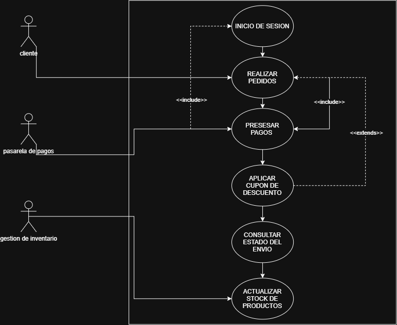
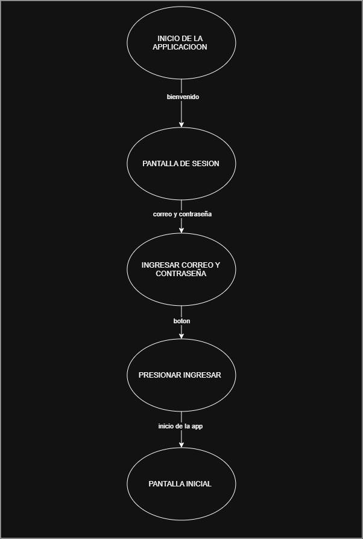
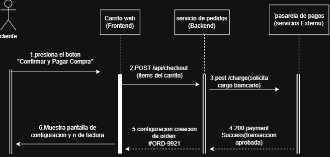

# Sistema de Gestión de Inventario - TechStore

## 1. Descripción del Proyecto
Escribe aquí un resumen de 2 líneas sobre un sistema de ventas. Utiliza **texto en negrita** para resaltar las características clave y *texto en cursiva* para el nombre de la empresa.

## 2. Requisitos del Sistema
Crea una lista de tareas (checklists) con los siguientes requisitos:
- [x] Python 3.10 o superior instalado
- [x] Base de Datos MySQL configurada
- [ ] Documentación técnica completada

## 3. Módulos del Sistema
Crea una tabla en Markdown con la siguiente estructura:

| Módulo | Descripción | Estado |
| :--- | :--- | :--- |
| Autenticación | Control de acceso y roles de usuario | Completado |
| Inventario | Registro y conteo de productos | En Proceso |
| Facturación | Generación de comprobantes de pago | Pendiente |

## 4. Ejemplo de Código Fuente
Inserta un bloque de código en Python formateado adecuadamente que contenga el siguiente algoritmo básico:

```python
def verificar_stock(cantidad):
    if cantidad > 0:
        return "Producto Disponible"
    else:
        return "Sin Stock"
´´´

## 5. Enlaces Útiles
- [Ver Arquitectura del Sistema](docs/arquitectura.md)
- [Ver Casos de Uso Hospitalarios](docs/arquitectura/casos-de-uso.md)
- [Ver Diagrama de Secuencia de Login](docs/arquitectura/secuencia-autenticacion.md)
- [Ver Arquitectura del Sistema](docs/arquitectura.md)
- [Ver Manual de Usuario](docs/manual_usuario.md)
- [Ver Especificación de API](docs/api_endpoints.md)
- [Ver Guía de Despliegue](docs/despliegue.md)
- [Ver Políticas de Seguridad](docs/seguridad.md)
- [Ver Historial de Cambios (CHANGELOG)](CHANGELOG.md)
- [Repositorio Oficial en GitHub](https://github.com/gaps3600/documentacion-sistema-v1-)

## Licencia y Gobernanza
* Este proyecto se distribuye bajo los términos de la **[Licencia MIT](LICENSE)**.
* Consulta nuestra **[Guía de Contribución](CONTRIBUTING.md)** para reportar fallos o
proponer mejoras.

(ejemplo: [](https://erick7096.github.io/documentacion-sistema-v1/)).

https://youtu.be/miCfQekehN4?si=psy6AUDs9MtjTHWJ

## Galería de imágenes del sistema

### 1. Pantalla principal


### 2. Inicio de sesión


### 3. Registro de usuario


### 4. Diagrama de casos de uso


### 5. Flujo de navegación


### 6. Diagrama de secuencia de autenticación


## Video tutorial del sistema

Mira el video para conocer el funcionamiento del sistema.

[▶ Ver video tutorial en YouTube](https://youtu.be/miCfQekehN4)

[📁 Ver o descargar el video MP4](docs/videos/videotutorial_proyecto.mp4)